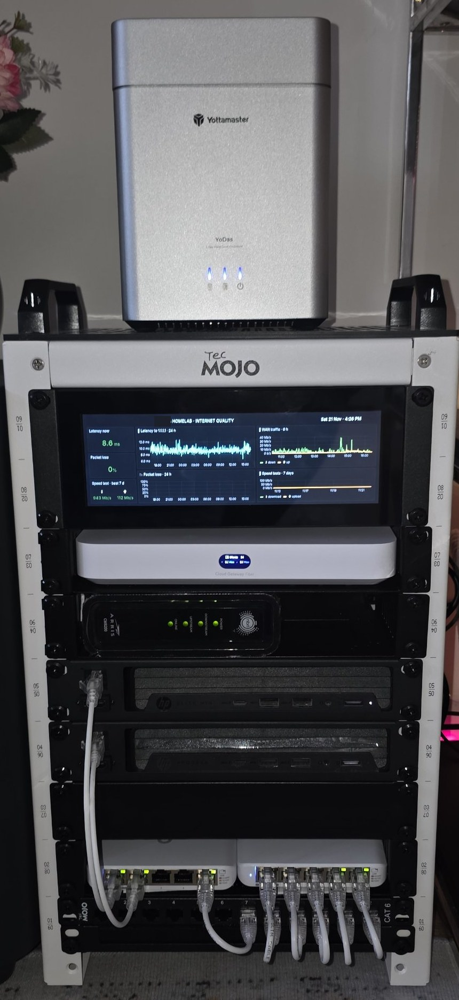

# Rack Display Kiosk on a Proxmox Node

Turns the **HDMI port of a Proxmox node** into a dashboard screen, with no extra Raspberry Pi and no desktop environment. The node auto-logs in a locked-down `kiosk` user on the console, which starts **[cage](https://github.com/cage-kiosk/cage)** (a minimal Wayland kiosk compositor) running Google Chrome full-screen.

<p align="center"></p>

Two modes:

| Mode | Shows |
|---|---|
| `kiosk` | The [Grafana rack dashboards](https://github.com/nashibbhattrai766-max/grafana-rack-dashboards), cross-fading every 15 s, with a dim clock at night |
| `browser` | A normal maximised Chrome window (e.g. a streaming site on a TV). Google Chrome is used instead of Chromium because it includes **Widevine** for DRM video. |

## Files

| File | Purpose |
|---|---|
| [`scripts/setup-kiosk.sh`](scripts/setup-kiosk.sh) | Installs cage, PipeWire audio, Chrome; creates the `kiosk` user, console auto-login and the launcher (waits for the network/Grafana, suppresses "Restore pages?" after power cuts) |
| [`scripts/install-rack-rotator.sh`](scripts/install-rack-rotator.sh) | Installs `rack.html` and points the kiosk at it |
| [`rack.html`](rack.html) | Rotator: two iframes that **pre-load the next screen hidden and cross-fade**, a night screen between 23:00 and 06:00, and a full reload every 6 h to keep Chrome's memory in check |

## Install

```bash
# on the node with the screen attached, as root
nano scripts/setup-kiosk.sh        # set MODE, GRAFANA_IP, BROWSER_URL
bash scripts/setup-kiosk.sh && reboot
bash scripts/install-rack-rotator.sh   # optional: smooth rotation instead of a Grafana playlist
```

Handy commands:

```bash
pkill -u kiosk chrome              # restart just the browser (it relaunches itself)
systemctl restart getty@tty1       # restart the whole kiosk session
# Ctrl+Alt+F2 on the console = root login, Ctrl+Alt+F1 = back to the kiosk
```

## Gotchas

- **Chrome and Pi-hole.** If the node's `/etc/resolv.conf` lists a public resolver (such as `8.8.8.8`) as a fallback, Chrome switches to encrypted DNS with that provider and ads get through even though the rest of the network is filtered. Keep only your own DNS servers on the node.
- **Graphics driver hangs.** On Intel iGPUs a stuck `i915_flip` kernel worker can sit in state `D` and inflate the load average. It clears on reboot. If it keeps coming back, consider moving the kiosk to another machine.
- **Sideways screens:** set `ROTATE="-r"` in the script.
- The hypervisor's own resources are tiny for this: Chrome uses roughly one CPU core at most while playing video.

## License

MIT
